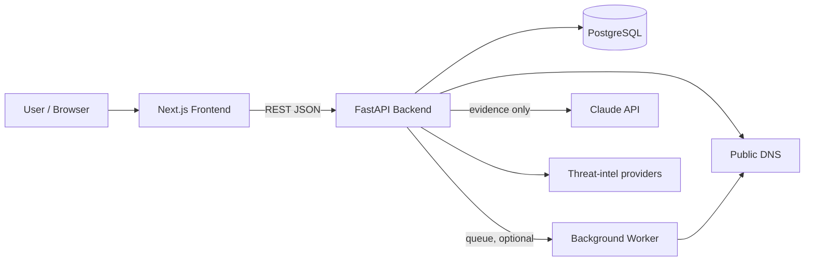
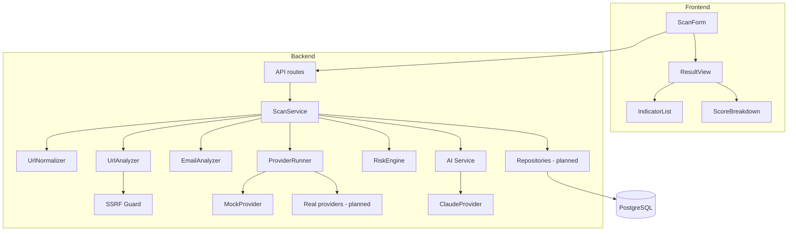
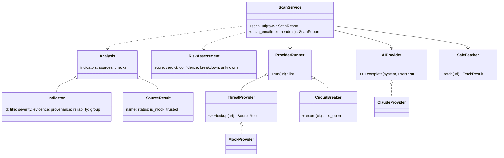
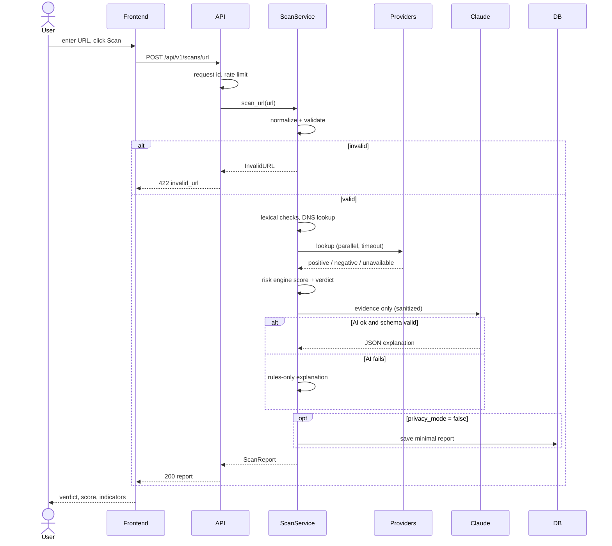
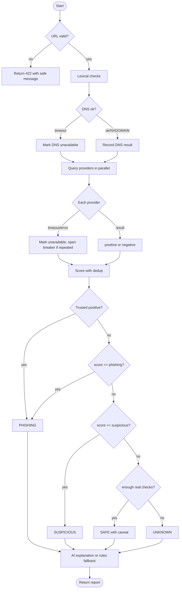
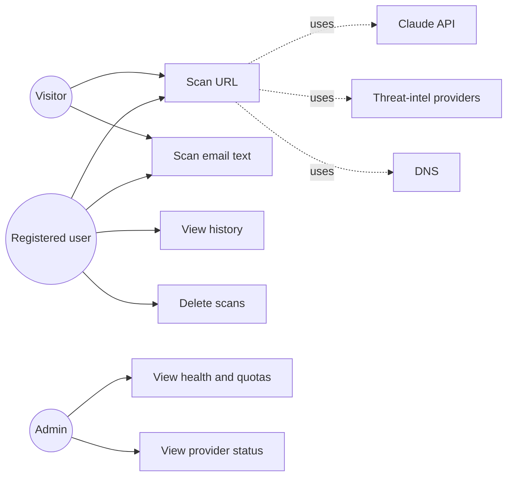
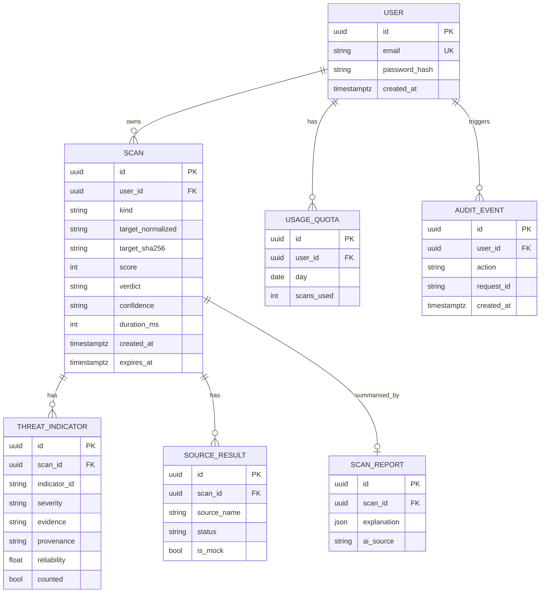
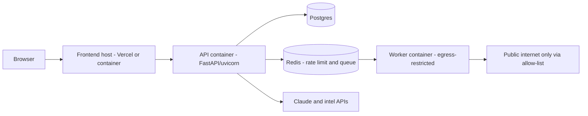
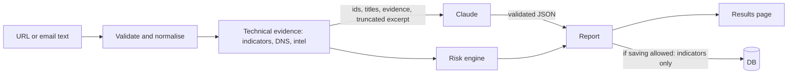
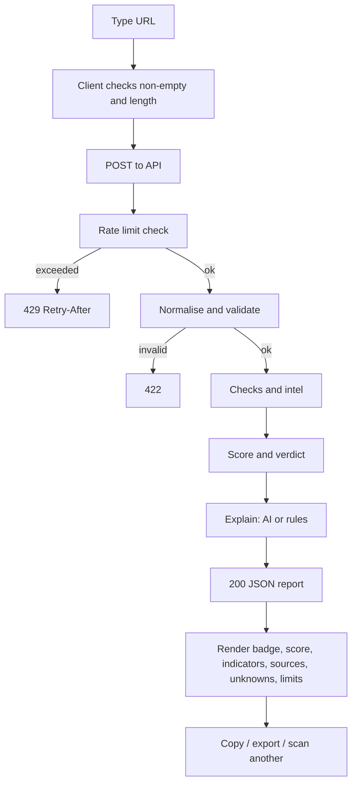

# PhishLens — Architecture and Diagrams

> The Mermaid diagrams below were written by hand and **not rendered or validated here** (no Mermaid CLI available in the build sandbox). Paste each into https://mermaid.live to check; tell me if any fails and I'll fix it.

## 1. Stack and why
| Layer | Choice | Why (beginner view) |
|---|---|---|
| Frontend | Next.js + TypeScript + Tailwind | Standard, lots of tutorials; **not built yet (Phase 3)** |
| Backend | FastAPI + Pydantic | Automatic validation and `/api/docs` page |
| Analysis core | Plain Python (stdlib) | Easy to test, no heavy deps |
| DB | PostgreSQL + SQLAlchemy/Alembic | Planned Phase 7; MVP currently keeps non-private scans **in memory** |
| Jobs | None in MVP (scans run synchronously, ~1–5 s) | Redis/Celery only needed once page-fetching/sandboxing is slow |
| AI | Claude via `ClaudeProvider` behind an `AIProvider` interface | Swappable; explains, never decides |

Simpler-alternative trade-off: SQLite instead of PostgreSQL and no Celery would be quicker to finish; Postgres/Redis are kept in `docker-compose` because the project brief asks for production-style structure.

## 2. Folder map (what exists today)
```
phishlens/
  backend/app/
    main.py                  FastAPI app, middleware (request id, rate limit, security headers)
    core/  config.py models.py rate_limit.py
    schemas/scan.py          request/response models (Pydantic)
    services/
      url_normalizer.py      validate + canonicalise URL (no network)
      ssrf_guard.py          IP blocking, DNS pinning, SafeFetcher with per-hop checks
      url_analyzer.py        deterministic URL indicators + real DNS lookup
      email_analyzer.py      text/header indicators
      threat_intelligence.py provider interface, MockProvider, timeouts, circuit breaker
      risk_engine.py         scoring policy (pure functions)
      ai_service.py          prompt, schema validation, rules-only fallback
      scan_service.py        orchestration
    tests/                   test_core.py (53 tests), test_api.py (needs FastAPI)
  docs/  infra/  frontend/(empty until Phase 3)
```
Not created yet: `models/` (SQLAlchemy), `repositories/`, `workers/`, `api/routes/` split (routes currently live in `main.py`), auth.

## 3. Diagrams

### A. System context


### B. Components


### C. Class diagram


### D. Sequence — URL scan


### E. Activity


### F. Use cases

Registration, history and admin views are designed, not implemented.

### G. Entity relationship (planned schema)

Indexes: `scan(user_id, created_at DESC)`, `scan(expires_at)`, unique `user(email)`, unique `usage_quota(user_id, day)`. Cascade delete from scan to children. **Retention:** email bodies and uploads are never stored (only a SHA-256 prefix); URL scans stored only when `privacy_mode=false`; default expiry 7 days via `expires_at` job.

### H. Deployment


### I. Data flow


### J. End-to-end flowchart


## 4. AI integration (answers to the brief's questions)
- **Where called:** `ScanService._finish` → `ai_service.explain`, after scoring.
- **Sent:** indicator ids/titles/evidence (≤300 chars each), source statuses, score/verdict, and for emails a control-char-stripped excerpt capped at `AI_MAX_INPUT_CHARS` (default 6000). Never sent: API keys, user identity, stored history.
- **Validation:** JSON extracted, validated with Pydantic (`AIAnalysis`), `evidence_references` filtered to real indicator ids.
- **Failure:** timeout, bad JSON, missing key → `rule_based_summary`, labelled `source: "rules"`.
- **Cost control:** one call per scan, `max_tokens=800`, truncated input, 1 retry, rate limit per IP.
- **Injection defence:** content is wrapped in `<untrusted_data>`; closing tags inside content are neutralised; system prompt forbids following embedded instructions; the AI **cannot change the score or verdict** (so an injection cannot flip a verdict).
- **AI vs deterministic:** deterministic checks produce evidence and the score; the AI only explains and spots wording patterns in email text (shown separately).
- **Not verified:** `ClaudeProvider` has not been run against the live API (no key/network in the sandbox).
